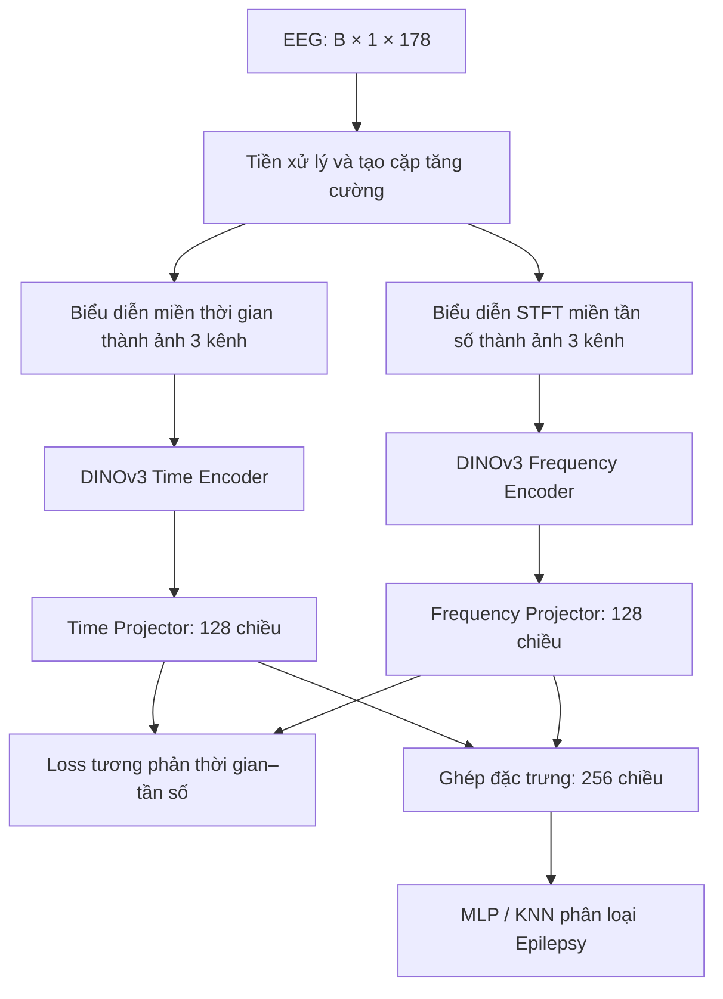

TF-C + DINOv3 — Học biểu diễn chuỗi thời gian bằng tương phản thời gian–tần số

Trạng thái: Đã chạy thử hai encoder DINOv3 pretrained, Pre-training 20 epoch, Fine-tuning và Testing 20 epoch trên tập con dữ liệu EEG.
Phạm vi: Đây là dự án thử nghiệm mô hình AI chạy bằng Python trên máy tính, chưa phải website/API triển khai cho người dùng. Các kết quả bên dưới sử dụng SleepEEG → Epilepsy

1. Project Overview — Tổng quan dự án
Dự án nghiên cứu việc thay thế hai encoder Transformer trong kiến trúc TF-C (Time-Frequency Consistency) bằng hai backbone DINOv3 ViT-S/16 pretrained độc lập. Hệ thống học biểu diễn tín hiệu EEG trong miền thời gian và miền tần số, sau đó sử dụng đặc trưng đã học cho bài toán phân loại Epilepsy. Do DINOv3 là backbone thị giác, tín hiệu chuỗi thời gian được chuyển thành ảnh đặc trưng trước khi đi vào mô hình.

Mục tiêu thực hiện:
1. Thay hai encoder gốc bằng DINOv3 thật 
2. Xây dựng bộ chuyển đổi tín hiệu → ảnh phù hợp cho từng nhánh.
3. Cập nhật Loss Function và tích hợp vào quá trình Pre-training/Fine-tuning.
4. Chạy thử thực tế trên EEG, lưu checkpoint và báo cáo chỉ số đánh giá.
Các file chứng minh thay đổi:
Nội dung	Mã nguồn
Hai DINOv3 độc lập, projector và classifier	[`code/TFC/model.py`](code/TFC/model.py)
Chuyển tín hiệu thành ảnh time/frequency	[`code/TFC/dinov3_adapter.py`](code/TFC/dinov3_adapter.py)
Loss Function mới	[`code/TFC/dinov3_loss.py`](code/TFC/dinov3_loss.py)
Liên kết loss mới với module loss	[`code/TFC/loss.py`](code/TFC/loss.py)
Gọi loss mới khi Pre-training và Fine-tuning	[`code/TFC/trainer.py`](code/TFC/trainer.py)
Tham số CLI và cấu hình thí nghiệm	[`code/TFC/main.py`](code/TFC/main.py)
Kiểm thử Loss, gradient	[`code/TFC/test_dinov3_loss.py`](code/TFC/test_dinov3_loss.py)
Kiểm thử cấu trúc encoder giả lập	[`code/TFC/smoke_test_dinov3.py`](code/TFC/smoke_test_dinov3.py)
Kiểm thử hai encoder pretrained thật	[`code/TFC/test_two_real_dinov3.py`](code/TFC/test_two_real_dinov3.py)

2. System Overview — Kiến trúc và luồng xử lý

- Input trong thí nghiệm EEG: Tensor (B, 1, 178), với B là batch size, một kênh tín hiệu và 178 bước thời gian.
- Biểu diễn ảnh: Hai ảnh 3 kênh, kích thước 224 × 224, được tạo bởi [`SignalImageAdapter`](code/TFC/dinov3_adapter.py).
- Encoder: Hai phiên bản DINOv3 ViT-S/16 có tham số độc lập, đầu ra mỗi nhánh 384 chiều.
- Projector: Mỗi nhánh cho vector 128 chiều; ghép lại thành 256 chiều.
- Classifier: MLP hoặc KNN, phục vụ đánh giá phân loại nhị phân Epilepsy.
- Cách chạy: Python local trên Windows; không có backend, cơ sở dữ liệu hoặc REST API trong nhánh thí nghiệm này.
Loss Function được cập nhật
Hàm [`DINOv3TFCLoss`](code/TFC/dinov3_loss.py) dùng biểu diễn của projector có thể học (z_t, z_f), thay vì tính các thành phần tương phản trên đặc trưng backbone bị đóng băng.
L_time  = NT-Xent(z_t, z_t_aug)
L_freq  = NT-Xent(z_f, z_f_aug)
L_cross = mean(
    NT-Xent(z_t,     z_f),
    NT-Xent(z_t,     z_f_aug),
    NT-Xent(z_t_aug, z_f),
    NT-Xent(z_t_aug, z_f_aug)
)

L_pretrain = 0.2 × L_time + 0.2 × L_freq + 1.0 × L_cross
L_finetune = CrossEntropy + 0.1 × L_pretrain
Temperature = 0.2

3. Environment — Môi trường và điều kiện tiên quyết
Thành phần	Yêu cầu / thông tin
Hệ điều hành đã chạy	Windows, Terminal PowerShell trong VS Code
Python	Python 3 với môi trường ảo .venv; kiểm tra phiên bản cụ thể bằng python --version
PyTorch	torch >= 2.2 theo requirements-dinov3.txt
Transformers	transformers >= 4.56.0
Hugging Face Hub	huggingface_hub >= 0.34
NumPy / scikit-learn	numpy >= 1.24, scikit-learn >= 1.3
Backbone	facebook/dinov3-vits16-pretrain-lvd1689m
Phần cứng đã kiểm chứng	Chạy thành công trên CPU; thời gian phụ thuộc phần cứng
Dữ liệu cần có	datasets/SleepEEG/train.pt, datasets/Epilepsy/train.pt, datasets/Epilepsy/test.pt

4. Setup — Cài đặt từ đầu trên Windows
Bước 1. Clone repository. Mở PowerShell ở thư mục bạn muốn lưu dự án:
git clone https://github.com/vuvandat109/TF-C-DINOv3.git
cd TF-C-DINOv3
Bước 2. Tạo và kích hoạt môi trường ảo (tại thư mục gốc vừa clone):
python -m venv .venv
.\.venv\Scripts\Activate.ps1
Nếu PowerShell chặn script kích hoạt, cho phép trong phiên Terminal hiện tại rồi thử lại:
Set-ExecutionPolicy -Scope Process -ExecutionPolicy RemoteSigned
.\.venv\Scripts\Activate.ps1
Kết quả mong đợi: Dòng lệnh bắt đầu bằng (.venv).

Bước 3. Cài dependency 
python -m pip install -r .\code\TFC\requirements-dinov3.txt
python --version
python -c "import torch, transformers; print('Torch:', torch.__version__); print('Transformers:', transformers.__version__)"
Bước 4. Kiểm tra ba file dữ liệu 
Test-Path .\datasets\SleepEEG\train.pt
Test-Path .\datasets\Epilepsy\train.pt
Test-Path .\datasets\Epilepsy\test.pt

Bước 5. Truy cập trọng số DINOv3 . Chấp thuận điều kiện truy cập tại Hugging Face, sau đó chạy:
hf auth login

5. Run & Verify — Chạy và xác nhận kết quả
Từ bước này, đổi thư mục làm việc sang code/TFC:
cd .\code\TFC
5.1. Kiểm thử Loss Function, không cần tải trọng số DINOv3
python test_dinov3_loss.py
Kết quả mong đợi:
PASS: DINOv3-TF-C loss, positive pairing and gradients in all four projected views
5.2. Kiểm thử hai encoder với backbone giả lập
python smoke_test_dinov3.py
Kết quả mong đợi:
PASS: both DINOv3 encoder slots replaced, adapters, output shapes and projector gradients
5.3. Kiểm thử hai DINOv3 pretrained thật
python test_two_real_dinov3.py
Kết quả đã quan sát trong lần chạy thử:
EEG input: torch.Size([2, 1, 178])
Independent encoders: True
Time features: torch.Size([2, 384])
Time projector: torch.Size([2, 128])
Frequency features: torch.Size([2, 384])
Frequency projector: torch.Size([2, 128])
Combined: torch.Size([2, 256])
Finite: True
SUCCESS: Both real DINOv3 encoders passed!
5.4. Pre-training bằng Loss mới
Chạy tại code/TFC:
python main.py --training_mode pre_train --pretrain_dataset SleepEEG --target_dataset Epilepsy --device cpu --subset
Dấu hiệu chạy đúng:
Mode:    pre_train
Pretraining on source dataset
DINOv3-TF-C pretrain | total=... | L_time=... | L_freq=... | L_cross=...
Pre-training Epoch : 1 | Train Loss : ...
Với cấu hình thí nghiệm SleepEEG_Configs.py: 20 epoch, learning rate 3e-4, batch size 8, seed 42. Cờ --subset giới hạn nguồn Pre-training vào 80 mẫu. Do main.py tự chọn CUDA khi có GPU, tham số --device cpu trong mã hiện tại không đảm bảo buộc chạy CPU nếu máy có CUDA.

Checkpoint sau khi hoàn thành:
code/experiments_logs/SleepEEG_2_Epilepsy/run1/
  pre_train_seed_42_dinov3_both/saved_models/ckp_last.pt
5.5. Fine-tuning và Testing từ checkpoint mới
Chỉ chạy bước này sau khi Pre-training hoàn tất:
python main.py --training_mode fine_tune_test --pretrain_dataset SleepEEG --target_dataset Epilepsy --device cpu --subset
Chương trình sử dụng 60 mẫu Fine-tuning và 600 mẫu Testing trong cấu hình --subset. Các dòng cần theo dõi:
Mode:    fine_tune_test
Fine-tune on Fine-tuning set
Epoch : 1
Finetune: loss = ... | Acc=... | F1=...
MLP Testing: Acc=... | F1=...
KNN Testing: Acc=... | F1=...
...
Best Testing Performance: ...
Best KNN F1 ...
Training is Done!
Vị trí file sau chạy:
File/thư mục	Vai trò
code/experiments_logs/SleepEEG_2_Epilepsy/...	Log Pre-training / Fine-tuning
code/experiments_logs/.../saved_models/ckp_last.pt	Checkpoint Pre-training
code/TFC/experiments_logs/finetunemodel/sleepedf2eplipsy_model.pt	Checkpoint model Fine-tuning theo đường dẫn đang được code sử dụng
code/TFC/experiments_logs/finetunemodel/sleepedf2eplipsy_classifier.pt	Checkpoint bộ phân loại MLP

6. Kết quả thực nghiệm đã chạy
6.1. Kiểm tra cấu trúc và suy luận
- test_dinov3_loss.py: PASS.
- smoke_test_dinov3.py (backbone giả lập): PASS.
- test_two_real_dinov3.py (hai DINOv3 pretrained thật): SUCCESS.
- Hai encoder có tham số độc lập; đầu ra là các tensor hữu hạn với kích thước như mục 5.3.
6.2. Pre-training — 20 epoch
Chỉ số	Kết quả
Dataset	SleepEEG, --subset (80 mẫu)
Epoch	20/20
Loss epoch 1	3.2115
Loss epoch 20	0.2784
L_time ở epoch 20	0.1390
L_freq ở epoch 20	0.1775
L_cross ở epoch 20	0.2151
Thời gian chạy thực tế	00:23:57.778917
Checkpoint	ckp_last.pt, đã kiểm tra tồn tại

Loss giảm mạnh qua 20 epoch, cho thấy quá trình tối ưu các projector bằng hàm loss mới đã diễn ra. Loss thấp không chứng minh riêng khả năng phân loại hoặc khả năng tổng quát hóa.
6.3. Fine-tuning / Testing — 20 epoch
Cấu hình kiểm thử: Epilepsy, 60 mẫu Fine-tuning, 600 mẫu Testing, CPU, --subset.
Metric	MLP Testing (Best Testing Performance)	KNN Testing (epoch có F1 tốt nhất)
Accuracy	18.50%	90.33%
Precision	9.25%	94.70%
Recall	50.00%	73.87%
F1-score	15.61%	79.52%
AUROC	67.83%	91.21%
AUPRC	72.78%	89.79%

7. AI Model — Thông tin phiên bản và giới hạn
Thuộc tính	Giá trị
Tên thí nghiệm	TF-C + DINOv3 ViT-S/16
Biến thể loss	DINOv3TFCLoss (NT-Xent thời gian, tần số, đối sánh chéo)
Checkpoint nguồn pretrained	facebook/dinov3-vits16-pretrain-lvd1689m
Đầu vào kiểm thử	EEG (B, 1, 178)
Đầu ra encoder	Hai vector 384 chiều
Đầu ra projector	Hai vector 128 chiều
Đầu ra phân loại	Logits 2 lớp Epilepsy
Version chạy thử	dinov3-tfc-loss / seed-42 / subset 
Trạng thái deployment	Chạy local qua command line, chưa có API/web app

Giới hạn hiện tại:
- Mô hình DINOv3 gốc được huấn luyện trên ảnh; việc biến đổi tín hiệu EEG thành ảnh là lựa chọn thử nghiệm, chưa bảo đảm tốt nhất cho chuỗi thời gian.
- dataloader.py đang lấy kênh đầu tiên của tín hiệu chuỗi thời gian; 
- Các backbone đang đóng băng theo mặc định; projector và classifier được huấn luyện.
- Các mẫu thử dùng --subset; chưa đo toàn tập, chưa có nhiều lần chạy với nhiều seed, chưa chứng minh cải thiện so với TF-C nguyên bản.
- Chưa có API, ngưỡng confidence, fallback hoặc luồng sử dụng cho người dùng cuối ở repository này.
- Không đẩy token Hugging Face, dữ liệu nhạy cảm, toàn bộ checkpoint lớn hoặc thư mục .venv lên repository công khai.
8. Usage — Cách sử dụng kết quả
Dự án hiện là pipeline nghiên cứu, không có endpoint POST /predict. Người dùng kỹ thuật có thể:
1. Chạy kiểm thử riêng từng thành phần theo mục 5.1–5.3.
2. Chạy Pre-training → Fine-tuning → Testing theo mục 5.4–5.5.
3. Đọc log tại code/experiments_logs/ và xem chỉ số Accuracy, Precision, Recall, F1, AUROC, AUPRC được in trên Terminal.
4. Sử dụng checkpoint được lưu ở mục 5.5 để nghiên cứu tiếp; cần cùng kiến trúc, cấu hình và trọng số DINOv3 thích hợp khi nạp lại.
Ví dụ kiểm tra checkpoint từ thư mục code/TFC:
Test-Path "..\experiments_logs\SleepEEG_2_Epilepsy\run1\pre_train_seed_42_dinov3_both\saved_models\ckp_last.pt"
Expected: True sau khi Pre-training hoàn tất.
9. Troubleshooting — Lỗi thường gặp
Hiện tượng	Nguyên nhân có thể	Cách xử lý
ModuleNotFoundError: transformers	Thiếu thư viện trong .venv	Kích hoạt .venv, chạy python -m pip install -r .\code\TFC\requirements-dinov3.txt từ thư mục gốc
401/403 khi tải DINOv3	Chưa được cấp quyền/đăng nhập Hugging Face	Chấp thuận quyền trên trang model, chạy hf auth login
FileNotFoundError ... train.pt	Thiếu dữ liệu hoặc chạy sai thư mục	Kiểm tra 3 đường dẫn ở mục Setup; chạy main.py từ code/TFC
ckp_last.pt không tìm thấy	Chưa Pre-training hoặc khác tên thư mục thí nghiệm	Chạy Pre-training trước, giữ cùng dataset/seed/run description
Máy chạy chậm ở Epoch 1	Hai backbone DINOv3 và STFT tiêu tốn CPU/RAM	Xem Task Manager, chạy --subset, cân nhắc GPU phù hợp
UndefinedMetricWarning	Có lớp không được classifier dự đoán	Kiểm tra phân bố nhãn/dự đoán, confusion matrix và cách huấn luyện MLP
MLP Accuracy thấp, chỉ số đứng yên	Fine-tuning chưa hội tụ, có thể liên quan checkpoint/optimizer/luồng đánh giá	Rà soát trainer.py, đặc biệt đoạn nạp mô hình tốt nhất trước các epoch tiếp theo; không báo KNN tốt là MLP cũng tốt
can't open file ...main.py	Chạy sai thư mục	cd code\TFC trước khi chạy python main.py

10. Tái lập thực nghiệm, nguồn tham khảo và giấy phép
Thông tin để tái lập: Repo code, dataset/split, seed 42, learning rate 3e-4, batch size Pre-training 8, 20 epoch, loss coefficients 0.2 / 0.2 / 1.0, fine-tuning SSL weight 0.1, checkpoint pretrained DINOv3 và phiên bản Python/packages thực tế. Nên lưu thêm pip freeze và log từ Terminal nếu muốn người khác so sánh kết quả chính xác hơn.

Tài liệu tham khảo:
1. TF-C — Self-Supervised Contrastive Pre-Training for Time Series via Time-Frequency Consistency, NeurIPS 2022.
2. TF-C project website.
3. DINOv3 pretrained ViT-S/16 — Hugging Face.
4. Repository thực nghiệm TF-C + DINOv3.
Dự án kế thừa và chỉnh sửa mã nguồn nghiên cứu TF-C. Xem LICENSE trong repository; khi dùng trọng số pretrained DINOv3 phải tuân thủ điều kiện và giấy phép tương ứng của bên cung cấp.
Ghi chú cho giảng viên: Có thể bắt đầu kiểm tra bằng [`model.py`](code/TFC/model.py) → [`dinov3_loss.py`](code/TFC/dinov3_loss.py) → [`trainer.py`](code/TFC/trainer.py), sau đó chạy ba bài kiểm thử trong mục 5 và đối chiếu kết quả thực nghiệm mục 6. Bản README này được cập nhật dựa trên cấu trúc source code GitHub cùng log chạy thực tế đã cung cấp; các hạn chế MLP và tính tái lập được ghi công khai.